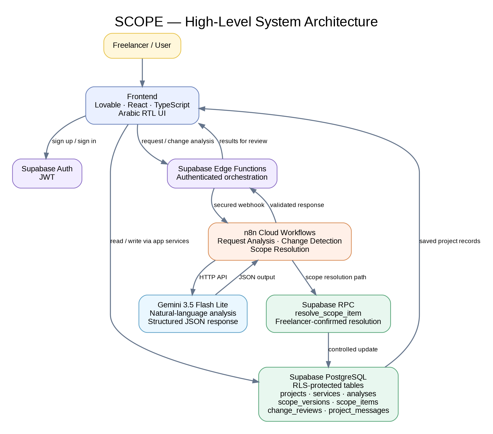

# SCOPE - AI-Powered Freelance Scope Management Assistant

SCOPE is an AI-powered assistant designed to help freelancers understand client requests, clarify missing requirements, define a clear scope of work, and manage changes against an approved agreement.

The project was developed as an individual capstone for the **AI & Intelligent Automation** program. The initial target audience is beginner freelancers, particularly graphic designers, with the potential to expand to other freelance disciplines in future versions.

> **Core principle:** AI helps the freelancer understand and assess the work. The freelancer remains responsible for reviewing results and making approval decisions.

## Contents

- [The Problem](#the-problem)
- [The Solution](#the-solution)
- [Key Features](#key-features)
- [How It Works](#how-it-works)
- [Technology Stack](#technology-stack)
- [System Architecture](#system-architecture)
- [AI Integration and Decision Logic](#ai-integration-and-decision-logic)
- [Data Model](#data-model)
- [Security and Responsible AI](#security-and-responsible-ai)
- [Testing and Validation](#testing-and-validation)
- [AI Content Package](#ai-content-package)
- [Demo and Access](#demo-and-access)
- [Current Limitations and Future Improvements](#current-limitations-and-future-improvements)
- [Repository Structure](#repository-structure)

## The Problem

Freelancers often receive client requests that are incomplete, ambiguous, or spread across multiple conversations. Before accepting a project, they may need to clarify deliverables, formats, deadlines, revision rounds, responsibilities, and exclusions.

After work begins, clients may request changes that were not part of the original agreement. This can lead to **scope creep**, unpaid work, missed deadlines, additional effort, and disagreements between the freelancer and the client.

The underlying problem is not that clients request changes. It is that freelancers may lack a clear, organized, and reviewable reference for what was actually agreed.

## The Solution

SCOPE provides a structured workflow for reviewing client requests before commitment and comparing later requests with the latest approved scope of work.

The platform helps freelancers:

1. Organize their services, deliverables, exclusions, and revision terms.
2. Analyze a client's message using AI.
3. Identify confirmed facts, missing information, ambiguities, and potential risks.
4. Generate relevant clarification questions and a professional draft message to the client.
5. Prepare and review a structured scope of work.
6. Approve an agreement version and preserve its history.
7. Compare new client requests with the latest approved scope.
8. Distinguish between work that is within scope, additional work, and requests that need clarification.

SCOPE is designed to support the freelancer's judgment, not replace it. AI-generated assessments and suggested messages remain subject to human review.

## Key Features

### Service Management

Freelancers can create and manage services and define relevant details such as deliverables, exclusions, revision rounds, pricing model, and other service conditions.

### Client Request Analysis

The Request Analysis workflow uses Gemini to interpret a client's message in the context of the selected service. It can produce:

- Confirmed facts explicitly stated by the client.
- Missing information required to understand the request.
- Ambiguities that may have more than one interpretation.
- Potential project and scope risks.
- A scope assessment using `within_scope`, `additional_work`, or `needs_clarification`.
- Suggested clarification questions.
- A professional draft message for the client.

### Scope Drafting and Approval

The freelancer can prepare a structured scope of work, review its items, and approve the agreement. Approved scope versions provide a reference for later change comparisons.

### Change Detection

The Change Detection workflow compares a new client message with the latest approved scope version. Each requested change can be classified as:

- `within_scope` - clearly covered by the approved agreement.
- `additional_work` - clearly outside the approved agreement.
- `needs_clarification` - the agreement does not provide enough evidence for a reliable decision.

The analysis is intended to include supporting agreement evidence, reasoning, potential impact, recommended action, missing information, risks, and a suggested response.

### Scope Resolution

A separate workflow validates a freelancer's proposed resolution of an unresolved scope item and calls the Supabase `resolve_scope_item` RPC. It requires explicit freelancer confirmation before the item is updated. The full end-to-end user-interface flow has not yet been verified.

### Version and Activity History

SCOPE stores project-related records, including scope versions, change reviews, and project messages, so the freelancer can refer to the project's history.

## How It Works

1. **Set up services:** The freelancer defines the services offered and their terms.
2. **Create a project:** The freelancer creates a project and enters the client's request.
3. **Analyze the request:** The application sends the request and relevant service information through the AI workflow.
4. **Review the analysis:** The freelancer reviews the extracted facts, missing details, ambiguities, risks, and suggested questions.
5. **Clarify with the client:** The freelancer can review and use the suggested professional message.
6. **Prepare the scope:** Once the requirements are sufficiently clear, the freelancer prepares a scope draft.
7. **Approve and preserve:** The freelancer reviews and approves the scope. The approved version becomes the reference for future comparisons.
8. **Review changes:** When a new client request arrives, SCOPE compares it with the approved scope and presents a classification and supporting reasoning.
9. **Decide and resolve:** The freelancer decides how to respond and whether an agreement update is required. The system does not approve additional work automatically.

## Technology Stack

| Layer | Technology | Responsibility |
|---|---|---|
| Frontend | Lovable, React, TypeScript | User interface and application experience |
| Frontend routing | TanStack Start / Router | Application routing and frontend structure, as represented in the project architecture |
| Backend platform | Supabase | Backend services and application data |
| Authentication | Supabase Auth, JWT | User registration and authenticated access |
| Database | Supabase PostgreSQL | Projects, services, analyses, scope versions, and activity records |
| Access control | Supabase Row Level Security (RLS) | Restricting records according to user ownership |
| Server-side operations | Supabase Edge Functions and RPC | Secure orchestration and controlled database operations |
| Workflow automation | n8n Cloud | Webhook-based workflow orchestration and service integration |
| AI model | Gemini 3.5 Flash Lite | Natural-language analysis and structured AI responses |
| API integration | HTTP APIs and Webhooks | Communication between the application, n8n, Gemini, and Supabase |

## System Architecture

At a high level, the system connects the user interface, Supabase, n8n, and Gemini.

```text
Freelancer
    |
    v
Lovable / React / TypeScript Frontend
    |
    v
Supabase Auth (JWT) and Application Services
    |
    +---- Supabase PostgreSQL (RLS-protected data)
    |
    +---- Supabase Edge Functions / RPC
                 |
                 v
              n8n Cloud
                 |
                 v
          Gemini 3.5 Flash Lite
                 |
                 v
       Structured AI response (JSON)
                 |
                 v
     Validation / application processing
                 |
                 v
       Supabase and the frontend
```

The three principal workflow responsibilities are:

| Workflow | Main responsibility | Exported webhook path |
|---|---|---|
| Request Analysis Agent | Analyze a client request against service information | `scope-request-analysis` |
| Change Detection Agent | Compare a new client message with an approved scope | `scope-change-detection` |
| Scope Resolution | Validate and apply a freelancer-confirmed scope item resolution | `scope-resolution` |

The architecture diagram above is a logical overview. The exported n8n JSON snapshots supplied during documentation review contain some nodes that appear disconnected from the main execution path. They should be reconciled with the live, tested workflows before being published as definitive import-ready workflow files.

## AI Integration and Decision Logic

SCOPE uses AI where language understanding and contextual interpretation are valuable, while deterministic application logic controls access, validation, and consequential state changes.

### Tasks Handled by AI

- Understanding client messages written in natural language.
- Extracting facts explicitly stated by the client.
- Identifying missing information and ambiguous requirements.
- Detecting potential scope and delivery risks.
- Assessing requested work against service terms or an approved agreement.
- Generating clarification questions and professional draft responses.
- Explaining why a requested change may be within scope, additional work, or in need of clarification.

### Tasks Handled by Deterministic Logic

- User authentication and JWT-based access.
- Row Level Security and record ownership checks.
- Input and identifier validation.
- Restricting allowed scope categories and classification values.
- Requiring explicit freelancer confirmation for scope resolution.
- Calling controlled Supabase RPC operations.
- Saving and retrieving application records and scope versions.

This separation helps prevent an AI-generated suggestion from becoming an approved commitment without the freelancer's review.

## Data Model

The Supabase project includes the following principal application tables:

| Table | Purpose |
|---|---|
| `profiles` | User profile records |
| `projects` | Freelancer projects |
| `services` | Services and service conditions |
| `request_analyses` | Client request analysis results |
| `scope_versions` | Scope of work versions and approval state |
| `scope_items` | Individual items within a scope version |
| `change_reviews` | Reviews of new client requests against an approved scope |
| `project_messages` | Project-related messages and activity history |

## Security and Responsible AI

### Authentication and Access Control

- Users can register through the application's Sign Up flow.
- Email confirmation is required before login.
- Supabase Auth provides authenticated user identity through JWTs.
- RLS is enabled on the eight application tables listed above.
- The reviewed policy inventory uses ownership checks based on `auth.uid()` and `WITH CHECK` expressions. The `profiles` table uses the authenticated user ID as its ownership reference.
- Project testing confirmed that users can access their own records, cannot access another user's records, and unauthenticated users cannot access protected data.

The policy inventory showed policies assigned to the `public` role with ownership expressions. Role targeting and database grants should be reviewed as part of a dedicated security review; the policy query alone is not a complete security audit.

### Data Sent for AI Processing

Client request and project information is sent to Gemini through n8n for analysis. Users should avoid entering passwords, API keys, payment credentials, or other highly sensitive information into client request fields.

A clear in-app warning about sensitive information was not visible in the reviewed request-entry screenshot. Adding a privacy notice and explaining AI data processing in the application are recommended improvements.

### Accuracy and Human Review

AI outputs may be incomplete or inaccurate. SCOPE is designed to distinguish confirmed facts from assumptions and to request clarification when the available information is insufficient. The freelancer can review and edit results and remains responsible for approving scope terms and changes.

For change detection, the approved agreement is the comparison reference. Unresolved items must not be treated as approved contractual evidence, and a missing clause must not automatically be interpreted as an exclusion.

### Intellectual Property

Project content and generated promotional materials should use assets that the project team has the right to use. Generated video, visual references, logos, and other third-party materials should be reviewed before publication.

## Testing and Validation

The project was tested through the following approaches:

- **Postman API testing** of application endpoints and API operations.
- **Manual UI testing** of the main user journeys and application screens.
- **Integration testing** across Supabase, n8n, and Gemini.
- **Access-control checks** for user-owned records and unauthenticated access.

The three workflow paths were reported as having reached integration testing successfully. The full Scope Resolution user-interface journey has not yet been tested end to end. The classification output and its evidence fields in Change Detection should also be retained with test evidence before being described as fully validated in every scenario.

A representative change-detection test used an approved vertical video deliverable and a subsequent client request to increase the duration and add a horizontal version. A similar scenario was executed in the application; the exact values in the presentation are illustrative of that test pattern.

Automated test-suite execution has not been confirmed and is therefore not claimed here.

### Development Issues and Improvements

Two examples from development:

1. **Gemini availability:** A `503 UNAVAILABLE` response occurred during model integration. The model configuration was changed to Gemini 3.5 Flash Lite, after which the workflow returned structured JSON responses in the tested path.
2. **Change Detection integration:** The change-review persistence and orchestration path required adjustment during development. The workflow and Supabase integration were revised and tested. The exported JSON snapshot currently needs to be reconciled with the live workflow because some nodes appear disconnected in the export.

## AI Content Package

The project includes a small content package to introduce SCOPE and explain the problem it addresses.

### Mini Brand Brief

- **Initial audience:** Beginner freelancers, especially graphic designers.
- **Content goal:** Explain scope creep, introduce SCOPE and its capabilities, and encourage freelancers to register and try the platform.
- **Main content:** A four-slide social media carousel supplied as the project's main content asset.
- **Supporting content:** A ten-scene AI-generated promotional video created using Google Vids.
- **Video format:** 16:9 landscape, cinematic commercial style, with an off-screen Palestinian/Levantine Arabic female voiceover.

### Prompt Engineering

The project's prompt work includes:

- The Request Analysis system prompt.
- The Change Detection system prompt.
- Input validation and response-processing logic in n8n.
- Scene-by-scene prompts for the ten-scene promotional video.
- A carousel creative brief and an improved version organized using the CTCO framework (Context, Task, Constraints, Output).

A documented prompt-improvement example addressed a final-scene generation issue in which the woman's appearance changed. The revised prompt added explicit character identity locks, environment locks, camera continuity requirements, and restrictions against regenerating the character or replacing the workspace.

## Demo and Access

| Resource | Link |
|---|---|
| Live SCOPE application | [Open the application](https://freelance-flow-companion.lovable.app/) |
| AI-generated promotional video | [Watch the SCOPE AI video](https://youtu.be/EFjBmgIvexA) |
| Recorded system demonstration | [Watch the SCOPE demo](https://youtu.be/j_sTIKTfxlU) |

### Access Instructions

1. Open the live application.
2. Select **Sign Up** to create an account.
3. Complete the email confirmation step.
4. Sign in after confirming the email address.

The application is hosted on Lovable. Access to the live application does not imply that the underlying Supabase or n8n administration workspaces are publicly accessible.

## Current Limitations and Future Improvements

Known limitations and areas for further work include:

- Complete and validate the Scope Resolution user-interface journey.
- Add further test evidence for Change Detection classifications, supporting evidence, and edge cases.
- Reconcile and re-export the n8n workflow JSON files so their exported connections match the tested live workflows before publishing them as importable assets.
- Add a clear privacy notice explaining that request information may be processed by an external AI service.
- Continue improving validation, error handling, and test coverage.
- Consider expanding the platform to freelancers in additional disciplines beyond the initial focus on graphic designers.
- Explore more advanced AI capabilities, such as agent-based workflows and Retrieval-Augmented Generation (RAG), in future versions. These are future directions, not features claimed in the current prototype.

## Repository Structure

The following structure is recommended for the project repository. Add each supporting file when it has been prepared and reviewed.

```text
SCOPE/
├── README.md
├── docs/
│   ├── client-proposal.pdf
│   ├── system-architecture.png
│   └── final-report.pdf
├── content/
│   ├── brand-brief.md
│   ├── main-content/
│   │   └── carousel/
│   ├── supporting-content/
│   │   └── ai-promotional-video-link.md
│   └── prompts.md
├── tests/
│   └── testing-evidence.md
└── assets/
    └── screenshots/
```

Do not commit passwords, API keys, access tokens, private customer data, or unredacted credentials. Workflow exports should be sanitized and verified before being added to a public repository.

---

**SCOPE - Understand the request. Define the agreement. Protect your work.**


## Project Assets and Evidence

### System Architecture


### Application Screenshots
The screenshots below document the current application interface and key user journeys:

- [Login page](assets/screenshots/application/01-login-page.png)
- [Dashboard](assets/screenshots/application/02-dashboard.png)
- [Services and service details](assets/screenshots/application/03-services-and-service-details.png)
- [New client request form](assets/screenshots/application/04-new-client-request-form.png)
- [AI request analysis results](assets/screenshots/application/05-ai-request-analysis-results.png)
- [Scope draft and approval](assets/screenshots/application/06-scope-draft-and-approval.png)
- [Change detection results](assets/screenshots/application/07-change-detection-results.png)
- [Project history](assets/screenshots/application/08-project-history.png)

### Main Content — Carousel
The four supplied carousel slides are included in [`content/main-content/carousel/`](content/main-content/carousel/).

### Workflow and Database Evidence
- [Request Analysis workflow screenshot](assets/screenshots/integrations/01-request-analysis-workflow.png)
- [Change Detection workflow screenshot](assets/screenshots/integrations/02-change-detection-workflow.png)
- [Scope Resolution workflow screenshot](assets/screenshots/integrations/03-scope-resolution-workflow.png)
- [Supabase table inventory screenshot](assets/screenshots/integrations/04-supabase-table-inventory.png)
- [Supabase RLS policy inventory](docs/supabase-rls-policy-inventory.csv)
- [Sanitized n8n workflow export notes](workflows/README.md)

For the full evidence status and remaining verification items, see [`tests/testing-evidence.md`](tests/testing-evidence.md) and [`docs/technical-review-notes.md`](docs/technical-review-notes.md).
