# SCOPE \| مساعد ذكي لإدارة نطاق العمل للمستقلين

<strong>افهمي طلب العميل، ثبّتي الاتفاق، واحمي وقتك.</strong>

<a href="https://freelance-flow-companion.lovable.app/">التطبيق
المباشر</a>  •  <a href="https://youtu.be/j_sTIKTfxlU">مشاهدة الديمو</a>
 •  <a href="https://youtu.be/EFjBmgIvexA">الفيديو الترويجي بالذكاء
الاصطناعي</a>

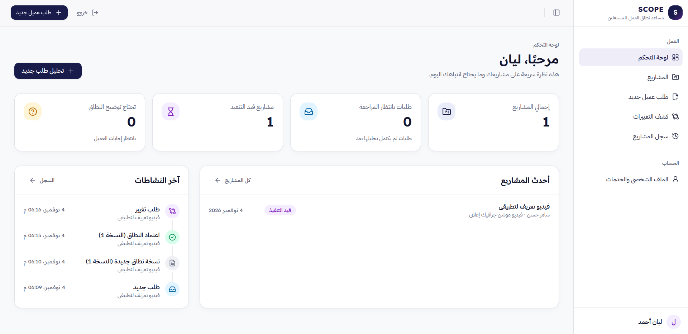

## نبذة عن المشروع

**SCOPE** هو مساعد ذكي لإدارة نطاق العمل (Scope of Work)، صُمّم لمساعدة
المستقلين على فهم طلبات العملاء قبل الالتزام بها، واكتشاف التفاصيل
الناقصة، وتنظيم الخدمات والمشاريع، وإعداد نطاق عمل واضح، ثم مقارنة
الطلبات اللاحقة بآخر اتفاق معتمد.

طُوّر المشروع بوصفه مشروعًا ختاميًا فرديًا ضمن برنامج **AI & Intelligent
Automation**. يستهدف الإصدار الحالي بصورة مبدئية المستقلين المبتدئين، مع
تركيز خاص على **مصممي الجرافيك**، مع إمكانية توسيع الجمهور مستقبلًا ليشمل
تخصصات مستقلة أخرى.

> **المبدأ الأساسي:** الذكاء الاصطناعي يساعد المستقل على الفهم والتحليل
> واقتراح الخطوات، لكن المستقل هو من يراجع النتائج ويتخذ قرار الاعتماد
> النهائي.

## المشكلة التي يعالجها SCOPE

قد تصل طلبات العملاء بصياغة عامة أو ناقصة أو موزعة على محادثات متعددة.
ويحتاج المستقل قبل بدء العمل إلى توضيح تفاصيل مثل المخرجات، والمقاسات،
والمدة، وعدد جولات التعديل، ومسؤوليات العميل، وموعد التسليم، والخدمات
المستثناة.

وبعد بدء المشروع قد يطلب العميل إضافات لم تكن جزءًا من الاتفاق الأصلي.
تُعرف هذه المشكلة باسم **Scope Creep — التوسع غير المنضبط في نطاق
العمل**، وقد تؤدي إلى:

- تنفيذ عمل إضافي دون مقابل واضح.
- ضياع الوقت والجهد بسبب المتطلبات غير المحددة.
- اختلاف التوقعات بين المستقل والعميل.
- صعوبة الرجوع إلى ما تم الاتفاق عليه.
- تأخر التسليم أو نشوء خلافات حول المسؤوليات والتكلفة.

المشكلة ليست في طلب التعديل بحد ذاته، بل في غياب مرجع واضح ومنظم يحدد ما
تم الاتفاق عليه بالفعل.

## الحل الذي يقدمه SCOPE

يوفر SCOPE مسار عمل يساعد المستقل على الانتقال من رسالة العميل الأولية
إلى نطاق عمل منظم وقابل للمراجعة، ثم متابعة التغييرات مقارنة بآخر نسخة
معتمدة.

يساعد النظام المستقل على:

1.  إدارة الخدمات والمشاريع وتحديد تفاصيل الخدمات ومخرجاتها
    واستثناءاتها.
2.  استقبال طلب العميل وتحليله باستخدام الذكاء الاصطناعي.
3.  استخراج الحقائق التي ذكرها العميل صراحةً وفصلها عن المعلومات الناقصة
    أو غير المؤكدة.
4.  اكتشاف الغموض والمخاطر المحتملة قبل الالتزام.
5.  اقتراح أسئلة توضيحية وصياغة رسالة مهنية جاهزة لمراجعة المستقل.
6.  إنشاء مسودة منظمة لنطاق العمل ومراجعتها.
7.  اعتماد نسخة من الاتفاق والاحتفاظ بإصداراته.
8.  مقارنة الطلبات الجديدة بآخر نطاق عمل معتمد.
9.  التمييز بين الطلبات المشمولة والعمل الإضافي والطلبات التي تحتاج إلى
    توضيح.
10. الاحتفاظ بسجل المشروع والرسائل والتغييرات.

## المميزات الرئيسية

### 1. إدارة الخدمات والمشاريع

يمكن للمستقل إنشاء المشاريع وإدارتها، وتعريف الخدمات وتفاصيلها، مثل
المخرجات المشمولة، والاستثناءات، وعدد جولات التعديل، ونموذج التسعير.

### 2. تحليل طلب العميل

يحلل النظام رسالة العميل بالاستناد إلى بيانات الخدمة، ويعرض:

- الحقائق المؤكدة الواردة في رسالة العميل.
- المعلومات الناقصة.
- العبارات والمتطلبات الغامضة.
- المخاطر المحتملة.
- تقييم المتطلبات بالنسبة إلى الخدمة.
- أسئلة توضيحية مقترحة.
- رسالة مهنية مقترحة للعميل قابلة للمراجعة والتعديل.

### 3. إعداد نطاق العمل واعتماده

يساعد النظام على تنظيم نطاق العمل في بنود واضحة، مثل المخرجات، والخدمات
المشمولة والمستثناة، ومسؤوليات العميل، وجولات التعديل، وموعد التسليم.
يراجع المستقل المسودة قبل اعتمادها.

### 4. اكتشاف التغييرات والعمل الإضافي

عند وصول طلب جديد من العميل، يقارنه النظام بآخر نسخة معتمدة من نطاق
العمل، ويستخدم ثلاثة تصنيفات:

| التصنيف                          | المعنى                                          |
|----------------------------------|-------------------------------------------------|
| <code>within_scope</code>        | الطلب مشمول بوضوح في الاتفاق المعتمد.           |
| <code>additional_work</code>     | الطلب يتجاوز الاتفاق المعتمد بدليل واضح.        |
| <code>needs_clarification</code> | لا توجد أدلة أو معلومات كافية لاتخاذ حكم موثوق. |

لا يُفترض أن غياب بند من الاتفاق يعني تلقائيًا أنه مستثنى، ولا يُعامل البند
غير المحسوم كأنه شرط تعاقدي معتمد.

### 5. إصدارات الاتفاق وسجل المشروع

يحتفظ النظام بإصدارات نطاق العمل وحالة اعتمادها، إلى جانب سجل الرسائل
والتغييرات المرتبطة بالمشروع، لتسهيل الرجوع إلى ما حدث.

## جولة مصوّرة داخل التطبيق

الصور التالية مأخوذة من واجهة SCOPE أثناء التطوير والاختبار.

### تسجيل الدخول ولوحة التحكم

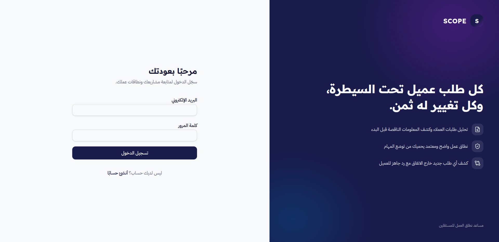
 

### إدارة الخدمات وطلب عميل جديد

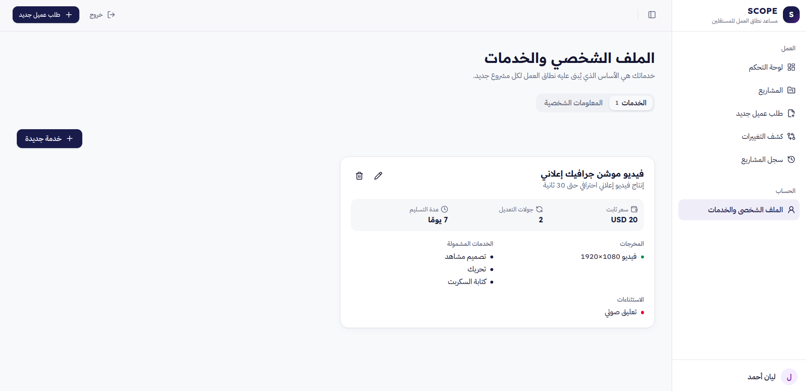
 
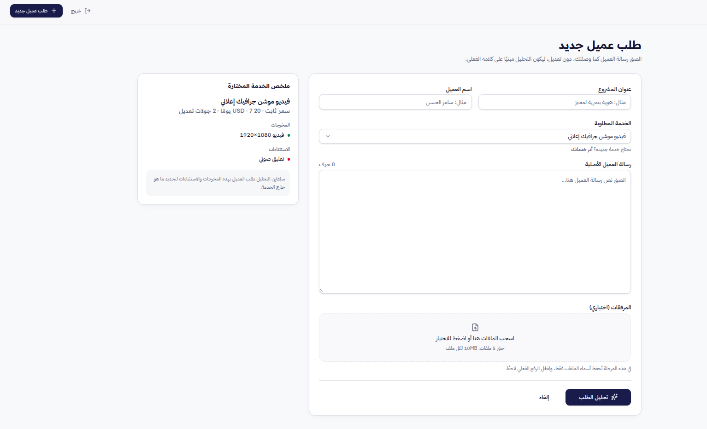

### نتائج تحليل الذكاء الاصطناعي

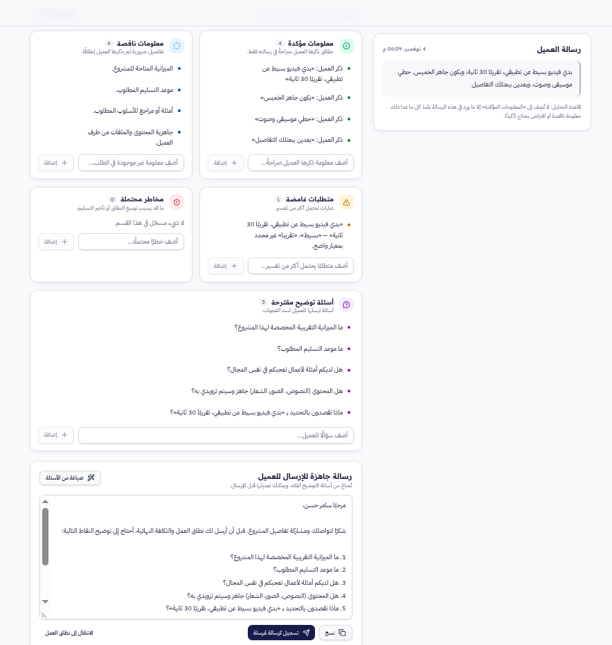

يعرض النظام المعلومات المؤكدة والناقصة، والمتطلبات الغامضة، والمخاطر،
والأسئلة التوضيحية، ورسالة مقترحة للعميل.

### مسودة نطاق العمل واعتماد الاتفاق

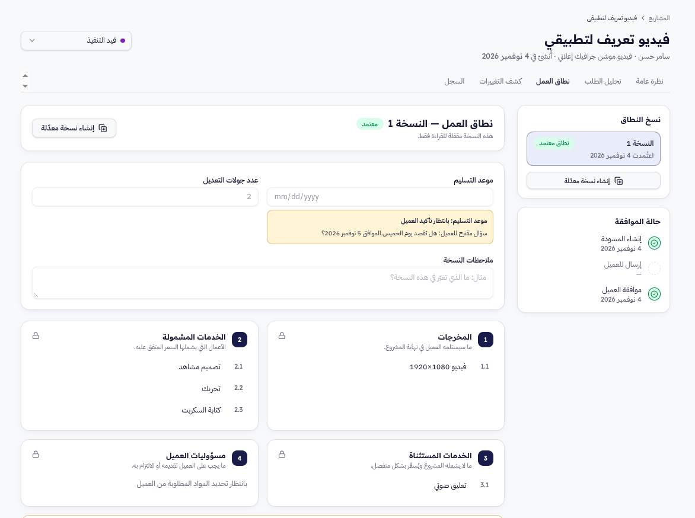

### اكتشاف التغييرات وسجل المشروع

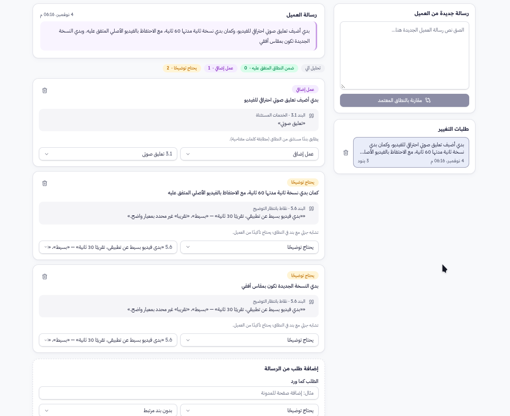

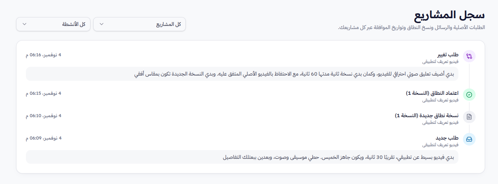

## كيف يعمل النظام؟

1.  **إعداد الخدمة:** يضيف المستقل الخدمة ويحدد تفاصيلها وشروطها.
2.  **إنشاء المشروع:** ينشئ مشروعًا جديدًا ويربطه بالعميل والخدمة.
3.  **إدخال الطلب:** يضيف رسالة العميل كما وردت.
4.  **تحليل الطلب:** تُرسل البيانات اللازمة إلى مسار التحليل عبر تكامل
    التطبيق وn8n وGemini.
5.  **مراجعة النتيجة:** يراجع المستقل الحقائق والمعلومات الناقصة والغموض
    والمخاطر والأسئلة والرسالة المقترحة.
6.  **توضيح المتطلبات:** يستخدم المستقل الأسئلة والرسالة المقترحة بعد
    مراجعتها، ويتابع رد العميل.
7.  **إعداد النطاق:** ينشئ مسودة نطاق عمل بناءً على المعلومات المتاحة.
8.  **الاعتماد:** يراجع المستقل النطاق ويعتمد النسخة المناسبة.
9.  **مقارنة التغييرات:** عند وصول طلب جديد، تتم مقارنته بآخر نسخة
    معتمدة.
10. **اتخاذ القرار:** يراجع المستقل النتيجة ويقرر كيفية التعامل مع
    الطلب؛ ولا يعتمد النظام العمل الإضافي تلقائيًا.

## البنية التقنية

يعتمد المشروع على مجموعة أدوات مترابطة، لكل منها دور محدد:

| الطبقة                 | التقنية                           | الاستخدام                                                       |
|------------------------|-----------------------------------|-----------------------------------------------------------------|
| الواجهة الأمامية       | Lovable، React، TypeScript        | بناء واجهة التطبيق وتجربة المستخدم.                             |
| المصادقة               | Supabase Auth وJWT                | التسجيل وتسجيل الدخول والتحقق من هوية المستخدم.                 |
| قاعدة البيانات         | Supabase PostgreSQL               | تخزين المشاريع والخدمات والتحليلات وإصدارات النطاق وسجل النشاط. |
| التحكم في الوصول       | Supabase Row Level Security (RLS) | تقييد الوصول إلى سجلات المستخدم وفق سياسات الملكية.             |
| العمليات الخلفية       | Supabase Edge Functions وRPC      | تنفيذ العمليات الخلفية والتحقق وتحديث البنود.                   |
| الأتمتة والتكامل       | n8n Cloud                         | تنسيق تدفقات العمل واستقبال Webhooks وربط الخدمات.              |
| نموذج الذكاء الاصطناعي | Gemini 3.5 Flash Lite             | فهم الرسائل وتحليل المتطلبات وإنتاج مخرجات منظمة بصيغة JSON.    |
| واجهات التكامل         | HTTP APIs وWebhooks               | تمرير البيانات بين التطبيق وn8n وGemini وSupabase.              |

### مخطط المعمارية

يوضح المخطط التالي المكونات الرئيسية والعلاقات العامة بينها. وهو مخطط
عالي المستوى، وليس بديلًا عن مراجعة إعدادات كل Workflow الفعلية.

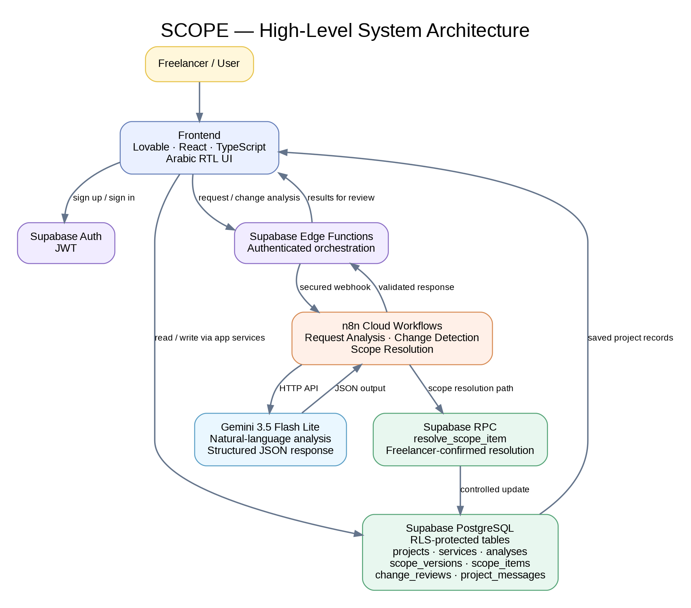

### تدفقات n8n الرئيسية

يحتوي المشروع على ثلاثة تدفقات أساسية:

| Workflow               | المسؤولية                                                      |
|------------------------|----------------------------------------------------------------|
| Request Analysis Agent | تحليل طلب العميل واستخراج الحقائق والنواقص والأسئلة المقترحة.  |
| Change Detection Agent | مقارنة الطلب الجديد بآخر نطاق معتمد وتقييم التغييرات.          |
| Scope Resolution       | التحقق من قرار المستقل وتحديث بند نطاق العمل عبر Supabase RPC. |

<strong>Request Analysis Agent</strong>

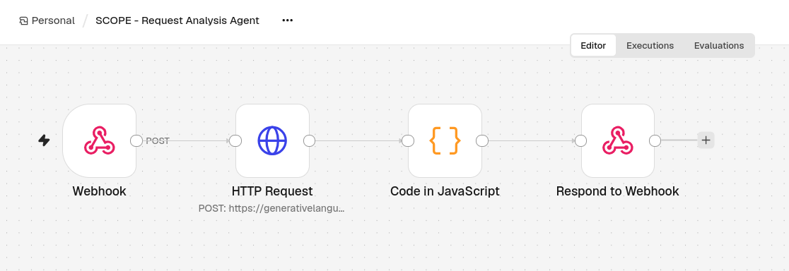

<strong>Change Detection Agent</strong>

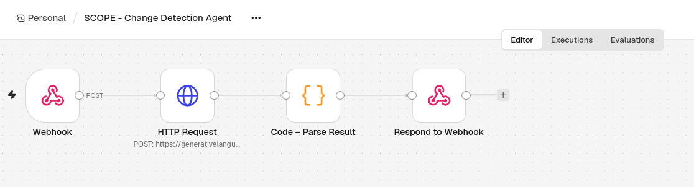

<strong>Scope Resolution</strong>

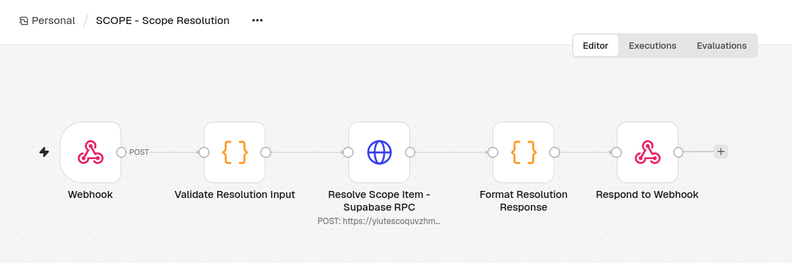

> **ملاحظة حول ملفات التصدير:** ملفات JSON الموجودة في
> <code>workflows/exports-review-only/</code> نسخ منقحة للمراجعة وليست
> ملفات إنتاج مؤكدة أو جاهزة للاستيراد. أظهرت مراجعتها وجود عقد غير
> متصلة في لقطات التصدير لبعض التدفقات؛ لذلك يجب مطابقتها مع النسخ الحية
> وإعادة تصديرها بعد التحقق قبل اعتبارها تمثيلًا نهائيًا للتنفيذ.

## قاعدة البيانات

تتضمن قاعدة بيانات Supabase الجداول الرئيسية التالية:

| الجدول                        | الغرض                                  |
|-------------------------------|----------------------------------------|
| <code>profiles</code>         | بيانات الملف الشخصي للمستخدم.          |
| <code>projects</code>         | المشاريع التي ينشئها المستقل.          |
| <code>services</code>         | الخدمات وشروطها ومخرجاتها.             |
| <code>request_analyses</code> | نتائج تحليل طلبات العملاء.             |
| <code>scope_versions</code>   | إصدارات نطاق العمل وحالة اعتمادها.     |
| <code>scope_items</code>      | البنود التفصيلية لكل نسخة نطاق.        |
| <code>change_reviews</code>   | نتائج مراجعة طلبات التغيير.            |
| <code>project_messages</code> | الرسائل وسجل التواصل المرتبط بالمشروع. |

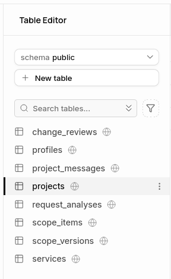

## دور الذكاء الاصطناعي مقابل القواعد التقليدية

### مهام الذكاء الاصطناعي — Gemini

- فهم رسائل العملاء باللغة الطبيعية.
- استخراج الحقائق التي وردت صراحةً.
- اكتشاف المعلومات الناقصة والغموض.
- تحديد المخاطر المحتملة.
- مقارنة طلبات التغيير بشروط الخدمة أو الاتفاق المعتمد.
- اقتراح الأسئلة التوضيحية والردود المهنية.
- تقديم تفسير وأدلة للتصنيف المقترح.

### مهام المنطق التقليدي والأتمتة

- المصادقة والتحقق من JWT.
- تطبيق سياسات RLS والتحقق من ملكية السجلات.
- التحقق من المدخلات والمعرّفات والتصنيفات المسموحة.
- اشتراط تأكيد المستقل قبل حل بند من بنود النطاق.
- استدعاء عمليات Supabase RPC المحددة.
- حفظ البيانات واسترجاع إصدارات النطاق وسجل المشروع.

**الخلاصة:** الذكاء الاصطناعي يفهم ويقترح، والمنطق التقليدي يتحقق ويحمي
وينفذ العمليات المحددة، والمستقل يحتفظ بقرار الاعتماد النهائي.

## الأمان والاستخدام المسؤول للذكاء الاصطناعي

### المصادقة وحماية البيانات

- يستطيع المستخدم إنشاء حساب من خلال Sign Up.
- تأكيد البريد الإلكتروني مطلوب قبل تسجيل الدخول.
- تستخدم المنصة Supabase Auth وJWT للمصادقة.
- تم تفعيل RLS على الجداول الأساسية الثمانية.
- أظهر جرد السياسات شروط ملكية تستند إلى <code>auth.uid()</code>، مع
  شروط <code>WITH CHECK</code>.
- أكدت اختبارات التطبيق أن المستخدم يستطيع الوصول إلى بياناته، ولا
  يستطيع الوصول إلى بيانات مستخدم آخر، وأن المستخدم غير المسجل لا يستطيع
  الوصول إلى البيانات المحمية.

أظهرت نتيجة جرد السياسات أن حقل الأدوار يعرض <code>public</code> في
السياسات التي تمت مراجعتها. لذلك ينبغي مراجعة استهداف الأدوار وصلاحيات
قاعدة البيانات بصورة مستقلة؛ فوجود شروط الملكية ونجاح الاختبارات لا يُعد
وحده تدقيقًا أمنيًا شاملًا.

### معالجة البيانات بواسطة الذكاء الاصطناعي

تُرسل بيانات الطلب والمشروع اللازمة للتحليل إلى Gemini عبر n8n. لم يظهر
في لقطة نموذج إدخال الطلب تنبيه صريح للمستخدم بشأن تجنب إدخال البيانات
الحساسة؛ لذلك يُوصى بإضافة إشعار خصوصية واضح يشرح معالجة البيانات، وينبّه
إلى عدم إدخال كلمات المرور أو مفاتيح API أو بيانات الدفع أو المعلومات
شديدة الحساسية.

### الدقة والمراجعة البشرية

قد ينتج الذكاء الاصطناعي مخرجات غير دقيقة أو غير مكتملة. لذلك:

- يراجع المستقل نتائج التحليل ويمكنه تعديلها.
- لا يتحول الموعد المقترح من العميل تلقائيًا إلى موعد تسليم معتمد.
- لا تُعامل المعلومات المستنتجة على أنها حقائق مؤكدة.
- لا تُعتمد التغييرات أو الالتزامات نيابة عن المستقل.
- تُستخدم النسخة المعتمدة من الاتفاق مرجعًا لمقارنة التغييرات.
- لا تُستخدم البنود غير المحسومة كأدلة تعاقدية.

## الاختبارات والتحقق

تم استخدام أكثر من أسلوب لاختبار المشروع:

- **Postman API Testing:** اختبار واجهات API والعمليات المرتبطة بها.
- **Manual UI Testing:** تجربة الوظائف الأساسية من خلال واجهة الموقع.
- **Integration Testing:** اختبار التكامل بين Supabase وn8n وGemini.
- **Access-Control Checks:** التحقق من عزل بيانات المستخدمين ومنع الوصول
  غير المسجل.

### حالة التحقق من الوظائف

| الوظيفة                                                    | الحالة المعلنة أثناء التوثيق                                     |
|------------------------------------------------------------|------------------------------------------------------------------|
| إدارة المشاريع والخدمات                                    | تعمل.                                                            |
| تحليل طلب العميل واستخراج المعلومات الناقصة والمخاطر       | تعمل.                                                            |
| اقتراح الأسئلة وصياغة رسالة العميل                         | تعمل.                                                            |
| إنشاء مسودة نطاق العمل واعتماد النسخ                       | تعمل.                                                            |
| اكتشاف التغييرات والعمل الإضافي                            | تعمل، مع الحاجة إلى إرفاق أدلة Postman ونتائج تفصيلية للتصنيفات. |
| تصنيف التغييرات مع الأدلة والأسباب                         | يحتاج إلى تأكيد تفصيلي إضافي.                                    |
| Scope Resolution من خلال واجهة المستخدم من البداية للنهاية | لم يُختبر بعد بصورة كاملة؛ مسار الـ Workflow وRPC موجودان.        |
| الاختبارات الآلية Automated Test Suite                     | لم يتم تأكيد تنفيذها، لذلك لا ندّعي وجودها.                       |

### مثال على مراجعة نتيجة الذكاء الاصطناعي

خلال تطوير تحليل الطلبات، اختبرنا رسالة عميل تتضمن طلب فيديو إعلاني
وموعدًا مقترحًا يوم الخميس، مع تفاصيل لم تكن مكتملة.

كان التحدي هو منع النموذج من:

- اعتبار كل الخدمات الموجودة في باقة المستقل طلبات فعلية من العميل.
- اعتبار الموعد الذي اقترحه العميل موعد تسليم معتمدًا.
- تحويل المعلومات غير المؤكدة إلى التزامات.

حُسّنت تعليمات النموذج لتفصل بين طلب العميل وشروط الخدمة، وتحافظ على حالة
المعلومات غير المؤكدة، وتستخدم <code>needs_clarification</code> عند
الحاجة إلى استيضاح.

### مشكلات تقنية عولجت

1.  **استجابة Gemini 503:** ظهر خطأ <code>503 UNAVAILABLE</code> أثناء
    التكامل. جرى تعديل إعداد النموذج إلى Gemini 3.5 Flash Lite، ثم عادت
    الاستجابات المنظمة بصيغة JSON في المسار الذي اختُبر.
2.  **تكامل Change Detection والحفظ:** احتاج مسار اكتشاف التغييرات وحفظ
    المراجعات إلى مراجعة وتعديل أثناء التطوير. ملفات التصدير المتاحة
    حاليًا لا تعكس جميع التوصيلات التي أُبلغ عن اختبارها في النسخة الحية،
    ولذلك أُبقيت ملاحظة المطابقة ضمن التوثيق.

## المحتوى التسويقي المساند

أُعدّت حزمة محتوى تعريفية لتوعية المستقلين بمشكلة Scope Creep، وشرح قيمة
SCOPE ومميزاته، وتشجيعهم على التسجيل.

### الكاروسيل التعريفي

يتكون المحتوى الرئيسي من أربعة تصاميم أصلية. تعتمد الهوية البصرية على
الأبيض والأسود والأصفر، وخلفيات شبكية، وشخصية قط أسود متكررة لعرض مواقف
المستقل بطريقة قريبة من الجمهور.

<table>
<tr>
<td align="center">
<strong>1 — المشكلة
والحيرة</strong> 
</td>
<td align="center">
<strong>2 — التعريف
بالحل</strong> 
</td>
</tr>
<tr>
<td align="center">
<strong>3 — داخل النطاق أم عمل
إضافي؟</strong> 
</td>
<td align="center">
<strong>4 — الدعوة
للتجربة</strong> 
</td>
</tr>
</table>

**الجمهور الأولي:** المستقلون المبتدئون، خصوصًا مصممي الجرافيك.  
**الأهداف:** التوعية بمشكلة Scope Creep، والتعريف بالمنصة ومميزاتها،
وتشجيع المستقلين على التسجيل.  
**أسلوب التواصل:** عربي عامي واضح وقريب من الجمهور.

### الفيديو الترويجي المولد بالذكاء الاصطناعي

أُنتج فيديو ترويجي مكوّن من عشرة مشاهد باستخدام **Google Vids**، وجُمعت
المشاهد في فيديو واحد. يعرض انتقال المستقلة من الحيرة أمام طلب عميل غير
واضح إلى استخدام SCOPE لتحليل الطلب وتوضيح المتطلبات وإعداد نطاق العمل
ومراجعة التغييرات وسجل الاتفاق.

ركزت Prompts الفيديو على:

- ثبات هوية الشخصية وملابسها.
- استمرارية المكان والإضاءة.
- اتصال المشاهد من الإطار الأخير للمشهد السابق.
- حركة الكاميرا السينمائية.
- التعليق الصوتي العربي الفلسطيني والمؤثرات الصوتية.
- دقة تمثيل واجهة SCOPE وتجنب عرض رسوم أو مزايا غير موجودة.

## هندسة الأوامر (Prompt Engineering)

شملت الأوامر المستخدمة:

- Prompt تحليل طلب العميل.
- Prompt اكتشاف التغييرات ومقارنتها بالاتفاق المعتمد.
- تعليمات التحقق من مدخلات Scope Resolution ومعالجة النتائج.
- Creative Brief لإنشاء الكاروسيل ونسخة محسّنة وفق إطار **CTCO: Context,
  Task, Constraints, Output**.
- Prompts المشاهد العشرة للفيديو الترويجي.

### مثال على تحسين Prompt

**المشكلة قبل التحسين:** في محاولة إنتاج المشهد الختامي، أعاد النموذج
توليد المرأة بملامح مختلفة عن الشخصية المستخدمة في المشاهد السابقة.

**التحسين:** أُعيدت صياغة البرومبت ليشمل:

- Character Identity Lock لتثبيت ملامح الشخصية والحجاب والملابس.
- Environment Lock لتثبيت المكتب والعناصر المحيطة.
- Exact Final Frame Continuity للبدء من الإطار الأخير نفسه.
- قيودًا على زاوية الكاميرا وحركتها.
- منع استبدال الشخصية أو توليد شعار أو نص داخل المشهد.

**الأثر:** أصبح البرومبت أكثر تحديدًا في حماية استمرارية الشخصية والمكان،
وأكدت مراجعة النسخة النهائية تجانس هوية الشخصية عبر المشاهد العشرة.

للتفاصيل، راجع [ملف Prompts](content/prompts.md) و[توثيق الفيديو
الترويجي](content/supporting-content/ai-promotional-video.md).

## روابط التجربة والعرض

| المورد                             | الرابط                                                      |
|------------------------------------|-------------------------------------------------------------|
| التطبيق المباشر                    | [فتح SCOPE](https://freelance-flow-companion.lovable.app/)  |
| فيديو العرض العملي للنظام          | [مشاهدة Live Demo](https://youtu.be/j_sTIKTfxlU)            |
| الفيديو الترويجي بالذكاء الاصطناعي | [مشاهدة AI Promotional Video](https://youtu.be/EFjBmgIvexA) |

### طريقة الوصول إلى التطبيق

1.  افتح رابط التطبيق.
2.  اختر **Sign Up** لإنشاء حساب.
3.  أكمل تأكيد البريد الإلكتروني.
4.  سجّل الدخول بعد تأكيد البريد.
5.  ابدأ بإعداد الخدمات والمشاريع.

توفر التطبيق لا يعني أن لوحات إدارة Supabase أو n8n متاحة للعامة؛ إذ
تتطلب هذه الخدمات صلاحيات دخول منفصلة.

## القيود الحالية والتطوير المستقبلي

### نقاط تحتاج إلى استكمال أو تحقق

- اختبار رحلة Scope Resolution كاملة من واجهة المستخدم.
- إرفاق صور Postman ونتائج التنفيذ التفصيلية.
- التحقق التفصيلي من تصنيف التغييرات والأدلة في حالات متعددة.
- إعادة تصدير Workflows بعد مطابقة التوصيلات مع النسخ الحية.
- مراجعة استهداف أدوار RLS وصلاحيات قاعدة البيانات.
- إضافة تنبيه خصوصية واضح للمستخدم يشرح معالجة بيانات الطلبات عبر خدمات
  الذكاء الاصطناعي.
- توسيع الاختبارات وتوثيق نتائجها.

### أفكار مستقبلية

- توسيع المنصة لتخدم مستقلين في مجالات أكثر.
- إضافة قدرات Agent متقدمة عند الحاجة.
- دراسة استخدام RAG للاستفادة من معرفة ومستندات مرتبطة بالمشاريع.
- تحسين التحقق من المخرجات وتغطية الاختبارات.
- تطوير أدوات المتابعة وفق احتياجات المستخدمين.

> **ملاحظة:** Agent وRAG أفكار تطوير مستقبلية، وليستا ميزتين منفذتين في
> النسخة الحالية.

## هيكل المستودع

<pre>
SCOPE/
├── README.md
├── assets/
│   └── screenshots/
│       ├── application/
│       └── integrations/
├── content/
│   ├── brand-brief.md
│   ├── main-content/
│   │   └── carousel/
│   ├── supporting-content/
│   │   └── ai-promotional-video.md
│   └── prompts.md
├── docs/
│   ├── SCOPE_Capstone_Presentation.pdf
│   ├── capstone-requirements.md
│   ├── demo-and-access.md
│   ├── system-architecture.png
│   ├── supabase-rls-policy-inventory.csv
│   └── technical-review-notes.md
├── tests/
│   └── testing-evidence.md
└── workflows/
    ├── README.md
    └── exports-review-only/
</pre>

## ملفات التوثيق والأدلة

- [متطلبات المشروع الختامي](docs/capstone-requirements.md)
- [العرض التقديمي](docs/SCOPE_Capstone_Presentation.pdf)
- [مخطط المعمارية](docs/system-architecture.png)
- [جرد سياسات RLS](docs/supabase-rls-policy-inventory.csv)
- [ملاحظات مراجعة Workflows](docs/technical-review-notes.md)
- [أدلة الاختبار](tests/testing-evidence.md)
- [Mini Brand Brief](content/brand-brief.md)
- [Prompts وهندسة الأوامر](content/prompts.md)

## ملاحظات قبل النشر على GitHub

- لا ترفع كلمات المرور أو مفاتيح API أو Access Tokens أو بيانات العملاء
  الحقيقية.
- ملفات Workflows المنقحة مخصصة للمراجعة والتوثيق، ولا تُعامل كنسخ إنتاج
  جاهزة للاستيراد.
- روابط الفيديو خارجية؛ ملفات الفيديو نفسها ليست مضمنة في المستودع.
- النص الأولي المحفوظ للكاروسيل هو Creative Brief، وليس Caption نهائيًا
  مستقلًا.
- لا تُعرض الاختبارات الآلية على أنها منفذة ما لم تُرفق نتائج تثبت ذلك.

<strong>SCOPE — افهمي الطلب، ثبّتي الاتفاق، واحمي وقتك.</strong>

## مستندات التسليم

- [مقترح المشروع — Client Proposal (PDF)](docs/client-proposal.pdf)
- [التقرير النهائي — Final Report (PDF)](docs/final-report.pdf)
- [نسخة Markdown من مقترح المشروع](docs/client-proposal.md)
- [نسخة Markdown من التقرير النهائي](docs/final-report.md)
- [الكابشن المقترح للكاروسيل](content/main-content/caption.md)
- [معاينة مجمعة للكاروسيل](docs/carousel-overview.png)

> الكابشن المرفق صياغة مقترحة أُعدّت أثناء استكمال التوثيق، وليس نصًا مؤكدًا
> أنه نُشر سابقًا.

- [حالة استكمال متطلبات Capstone](docs/deliverables-status.md)
